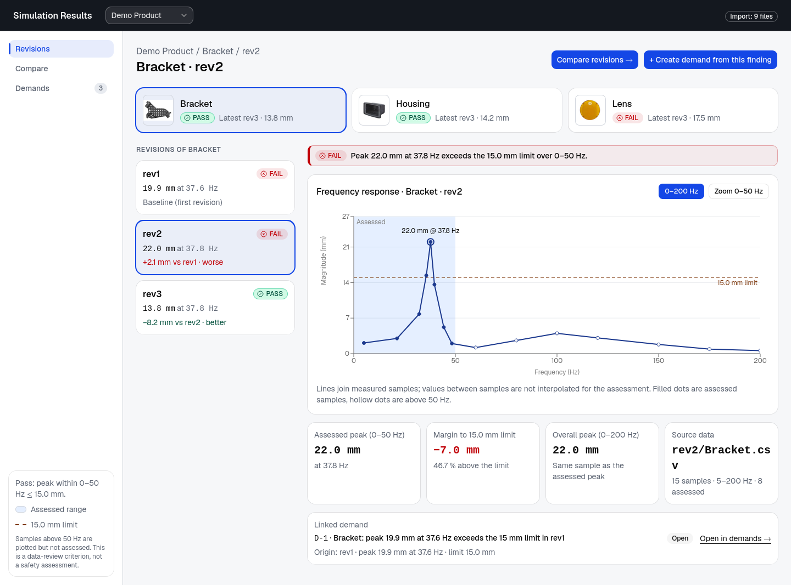
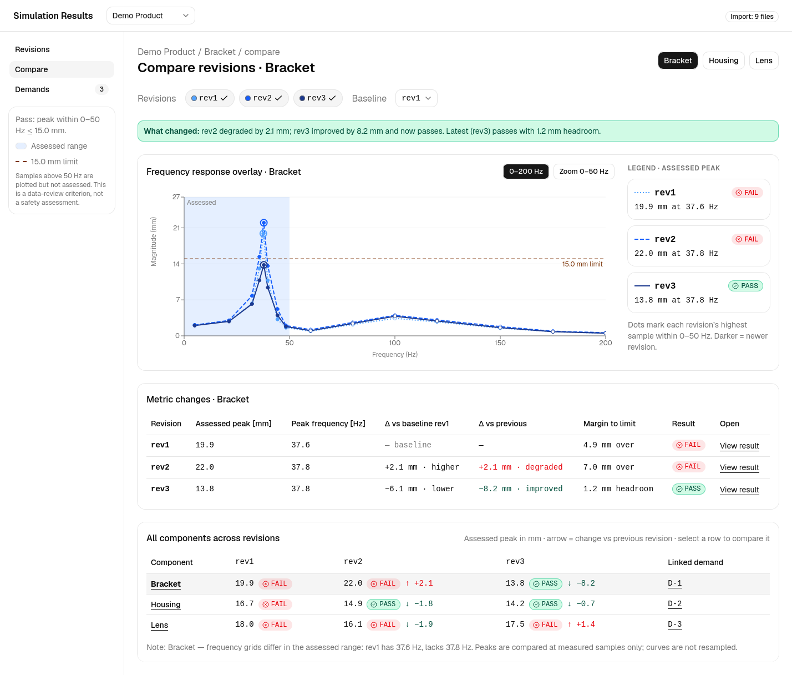
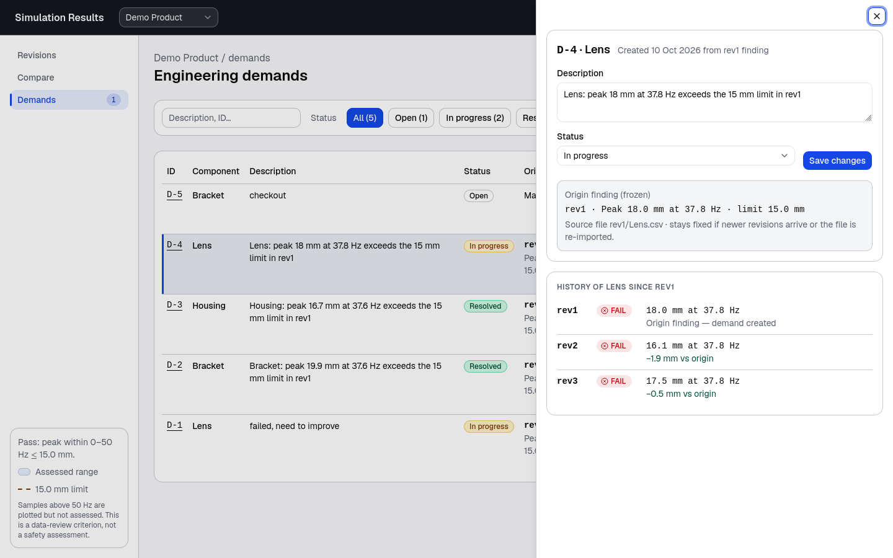
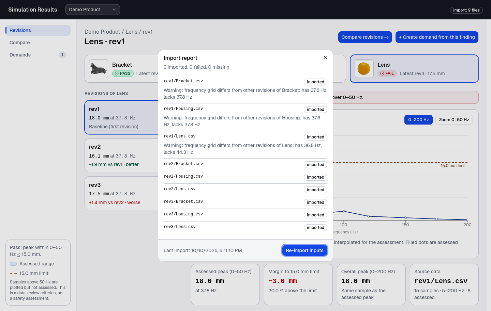

# Simulation Results Dashboard

A web dashboard for reviewing frequency-response simulation results. It imports the CSVs in `Inputs/` into a database, assesses every component revision against the review rule (peak within 0–50 Hz at or below 15.0 mm), and lets an engineer inspect a revision, compare revisions, and raise and track follow-up demands.

The verdict is a data-review criterion, not a safety assessment.

- `backend/` — FastAPI service (Python, managed with uv), SQLite database
- `frontend/` — React + TypeScript app (Vite)
- `Inputs/` — the supplied CSVs, one folder per revision, plus one image per component

Design decisions, assumptions and open questions are in [DECISIONS.md](DECISIONS.md).

## Requirements

| Tool    | Version                                                              |
| ------- | -------------------------------------------------------------------- |
| Python  | 3.12 or newer (uv installs it for you if it is missing)              |
| uv      | any recent release — <https://docs.astral.sh/uv/>                    |
| Node.js | 20.19+ or 22.12+ (what Vite 8 needs); developed on 24, with npm      |
| make    | GNU make                                                             |

## Install

```sh
git clone git@github.com:ATOM43/sim-results-dashboard.git
cd sim-results-dashboard
make install
```

`make install` runs `uv sync` in `backend/` and `npm install` in `frontend/`.

## Load the data

A fresh clone has no database. Run both commands once, in this order:

```sh
make import         # read Inputs/ into the database
make seed-demands   # create the three starter demands
```

- **`make import`** walks `Inputs/rev<number>/<Component>.csv`, validates each file, stores its samples and computes its verdict. It prints one line per file (`inserted`, `updated`, `unchanged`, `failed`) with the reason for any failure, and exits non-zero if a file failed. It is safe to run again: unchanged files are skipped, an edited file updates its existing result, and a new `rev4/` folder is picked up without code changes.
- **`make seed-demands`** raises one demand for each component from its failing rev1 result (Bracket, Housing and Lens). It needs the import to have run first, and running it twice creates nothing new.

Without the import the dashboard is empty; without the seed the Demands page is empty until you create a demand yourself.

The database is `backend/data/app.db`. Delete that file and run the two commands again to start over.

## Run

```sh
make dev
```

| What         | URL                          |
| ------------ | ---------------------------- |
| Dashboard    | <http://localhost:5173>      |
| API          | <http://localhost:8000/api>  |
| API docs     | <http://localhost:8000/docs> |

Stop both with Ctrl+C. Both ports must be free: the API only accepts browser requests from port 5173, so if Vite reports it moved to another port, stop whatever holds 5173 and start again.

Re-import while the app is running from the UI (click the import badge in the header, then **Re-import inputs**) or with `make import` in a second terminal.

Optional environment variables: `SIM_INPUTS_DIR` (inputs folder), `SIM_DB_PATH` (database file), `VITE_API_URL` (API address the web app calls).

## Test and lint

```sh
make test   # pytest (backend) and Vitest (frontend)
make lint   # ruff, ruff format --check, pyright; oxlint, tsc, Prettier
make format # apply ruff format and Prettier
```

## Review workflow

1. **Pick a project.** The selector in the header lists the projects in the database. The supplied data is one project, "Demo Product". The badge on the right shows the import state; click it for the per-file report.

2. **Inspect a revision.** On **Revisions**, choose a component card, then a revision. The banner states the verdict in words, the chart shows the response with the assessed 0–50 Hz band, the 15.0 mm limit and the peak labelled, and the cards below give the assessed peak, margin to the limit, overall peak and source file. A failing result offers **Create demand from this finding**.

   

3. **Compare revisions.** On **Compare**, toggle the revisions to overlay and choose the baseline. The "What changed" line summarises the movement, the table gives each revision's delta against the baseline and against the previous revision, and the grid at the bottom shows every component across every revision. Click a grid row to switch component. A note appears when revisions were sampled at different frequencies.

   

4. **Trace a demand across revisions.** On **Demands**, filter by status, component or text. Each row shows the origin finding, the component's result in every revision since, and the latest result. Select a row to edit its description and status and to read its history. **Origin result** and **Compare revs** jump back to the evidence. A demand stays open when a later revision passes; resolving it is the engineer's decision.

   

5. **Check the import.** The header badge turns amber when a file failed or went missing. The report lists those files first with the reason, and shows any warnings on files that did import, such as a differing frequency grid.

   

Every view is a URL: the selected project, component, revisions and filters are in the query string, so a link reopens the same view.
